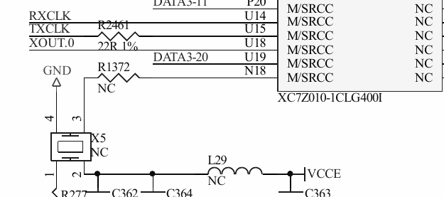
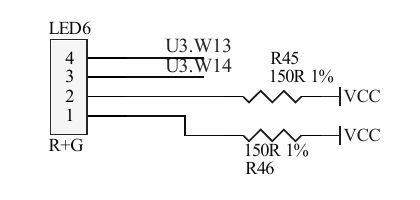
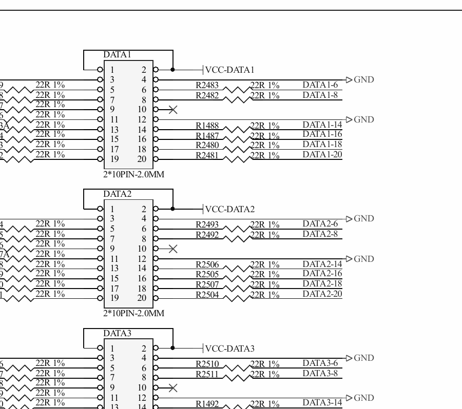

# EBAZ4205 Board Reference

[English](README.md) | [Tiếng Việt](README.vi.md)

Pin and hardware facts used by every lab, each traced to the vendor schematic in [xjtuecho/EBAZ4205](https://github.com/xjtuecho/EBAZ4205) (`HW/ebaz4205/EBAZ4205-SCH.pdf`) or measured in [Lab 00](../labs/lab00_bringup/README.md).

## Folder Structure

```
board/
├── README.md / README.vi.md          # this reference
├── ebaz4205_master.xdc               # all usable PL pins, commented out
├── LICENSE-xjtuecho-EBAZ4205.txt     # MIT license of the upstream XDC / schematic
└── docs/
    ├── led6_schematic.png            # dual LED wiring (polarity evidence)
    ├── x5_oscillator_schematic.png   # 50 MHz oscillator to pin N18
    └── data_headers_schematic.png    # DATA1/2/3 header pinout
```

## Device

| Item | Value | Source |
|---|---|---|
| SoC | XC7Z010, CLG400, grade `1C` | Chip marking (Lab 00) |
| Vivado part | `xc7z010clg400-1` | Lab 00 |
| JTAG IDCODE | `0x13722093` | Lab 00 |
| PS DDR3 | 256 MB | Upstream README |
| XADC | **Not usable** — `VCCADC_0` unpowered | Lab 00 |

## PL Clock

| Signal | Pin | Frequency | Constraint |
|---|---|---|---|
| `clk_50m` | N18 | 50 MHz (X5) | `create_clock -period 20.000` |

X5 is marked **NC** in the vendor schematic (not fitted on the original miner board); on this board it was fitted by the seller. The upstream XDC uses a 10 ns period, which is wrong for a 50 MHz oscillator — the master XDC here uses 20 ns.



## On-board LED (LED6, red + green)

| Signal | Pin | Polarity |
|---|---|---|
| `led_g_n` | W13 | **Active-low** |
| `led_r_n` | W14 | **Active-low** |

Both LED anodes go to VCC through 150 Ω (R45, R46); the cathodes go to W13 / W14. Driving the pin **low** lights the LED. Both on together gives yellow/orange. Signal names end in `_n` to make the polarity visible in RTL.



There is also a *Done* LED (LED1) connected to the configuration `DONE` pin; it shows the configuration state and is not user-controllable. Its on/off behaviour after loading a bitstream will be recorded in Lab 01.

## DATA1 / DATA2 / DATA3 Headers

2×10 pins, **2.0 mm pitch** (not 2.54 mm). Every I/O passes through a 22 Ω series resistor.

| Pin | Function |
|---|---|
| 1, 2 | **VCC-DATAx — board supply input. Never connect logic here.** |
| 3 | Not mapped in the master XDC — do not use |
| 4, 12 | GND |
| 10 | NC |
| 5–9, 11, 13–20 | PL I/O, LVCMOS33 (3.3 V only) |



### Pins used by the labs

| Lab | Signal | Header pin | FPGA pin | Wiring |
|---|---|---|---|---|
| 03+ | `btn_n` | DATA1-5 | A20 | Push button to GND (DATA1-4), internal `PULLUP` |
| 05+ | `uart_txd` | DATA1-6 | H16 | To USB-UART **RXD** |
| 06+ | `uart_rxd` | DATA1-8 | B20 | From USB-UART **TXD** |
| 05+ | GND | DATA1-4 | — | USB-UART GND |

Set the CH343P adapter to **3.3 V** logic level before connecting.

## Debug Ports

| Port | Use |
|---|---|
| J8 | JTAG (Digilent-compatible cable detected in Lab 00) |
| J7 | PS UART (TXD, RXD, GND; do not connect VCC) |

## Power

12 V adapter on J4 with Schottky diode D24 fitted. Supply input current ≥ 400 mA (upstream README).
