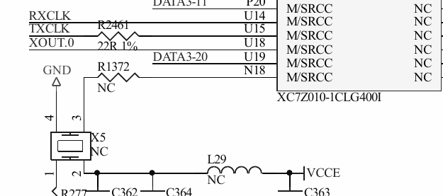
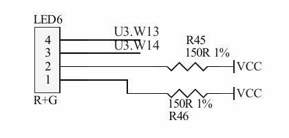
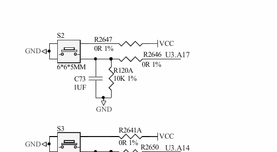
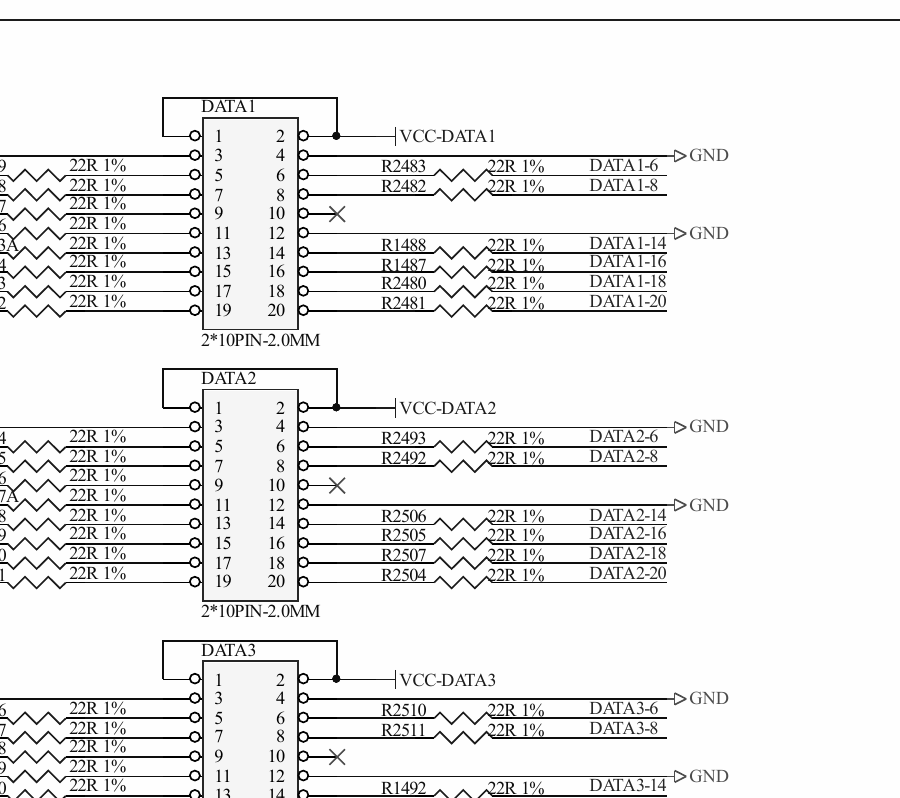

# Tài liệu tham chiếu board EBAZ4205

[English](README.md) | [Tiếng Việt](README.vi.md)

Thông tin chân và phần cứng dùng chung cho mọi lab. Mỗi thông tin đều truy được về schematic gốc trong [xjtuecho/EBAZ4205](https://github.com/xjtuecho/EBAZ4205) (`HW/ebaz4205/EBAZ4205-SCH.pdf`) hoặc đã đo trong [Lab 00](../labs/lab00_bringup/README.vi.md).

## Cấu trúc thư mục

```
board/
├── README.md / README.vi.md          # tài liệu này
├── ebaz4205_master.xdc               # toàn bộ chân PL dùng được, đang comment
├── LICENSE-xjtuecho-EBAZ4205.txt     # giấy phép MIT của XDC / schematic gốc
└── docs/
    ├── led6_schematic.png            # sơ đồ nối LED kép (bằng chứng cực tính)
    ├── x5_oscillator_schematic.png   # thạch anh 50 MHz vào chân N18
    ├── data_headers_schematic.png    # sơ đồ chân header DATA1/2/3
    └── s2_button_schematic.png       # nút S2 trên board (thuộc PS MIO, không phải PL)
```

## Chip

| Mục | Giá trị | Nguồn |
|---|---|---|
| SoC | XC7Z010, CLG400, grade `1C` | Chữ in trên chip (Lab 00) |
| Part trong Vivado | `xc7z010clg400-1` | Lab 00 |
| JTAG IDCODE | `0x13722093` | Lab 00 |
| DDR3 của PS | 256 MB | README repo gốc |
| XADC | **Không dùng được** — `VCCADC_0` không có nguồn | Lab 00 |

## Clock của PL

| Tín hiệu | Chân | Tần số | Constraint |
|---|---|---|---|
| `clk_50m` | N18 | 50 MHz (X5) | `create_clock -period 20.000` |

Trong schematic gốc X5 ghi **NC** (máy đào gốc không hàn); trên board này shop đã hàn thêm. XDC của repo gốc dùng chu kỳ 10 ns, sai với thạch anh 50 MHz — master XDC ở đây dùng 20 ns.



## LED trên board (LED6, đỏ + xanh)

| Tín hiệu | Chân | Cực tính |
|---|---|---|
| `led_g_n` | W13 | **Active-low** |
| `led_r_n` | W14 | **Active-low** |

Anode của cả hai LED nối lên VCC qua điện trở 150 Ω (R45, R46), cathode nối vào W13 / W14. Kéo chân xuống **0** thì LED sáng. Bật cả hai cùng lúc ra màu vàng/cam. Tên tín hiệu có hậu tố `_n` để nhìn RTL là biết active-low.



## Nút S2 trên board (chỉ dùng từ PS)

| Mục | Giá trị |
|---|---|
| Chân | A17 = `PS_MIO20` (bank 501 của PS) |
| Cực tính | **Tích cực mức cao**: nhấn thì chân nối lên VCC; khi thả, điện trở 10 kΩ (R120A) kéo chân xuống GND |
| Lọc | Tụ 1 µF (C73): chống dội bằng mạch RC phần cứng |
| S3 | Chỉ có chỗ hàn, không gắn nút |

S2 nối vào một chân MIO của PS, nên thiết kế chỉ dùng PL (Lab 01–08) không đọc được nó, và không thể khai báo A17 trong file XDC. Nút này dùng được từ Lab 09, khi phần mềm chạy trên hệ thống xử lý đọc nó qua bộ GPIO của PS.



Ngoài ra có LED *Done* (LED1) nối với chân `DONE` của khối cấu hình: nó báo trạng thái cấu hình, người dùng không điều khiển được. LED này sáng hay tắt sau khi nạp bitstream sẽ được ghi lại ở Lab 01.

## Header DATA1 / DATA2 / DATA3

2×10 chân, **bước chân 2.0 mm** (không phải 2.54 mm). Mỗi chân I/O đi qua một điện trở nối tiếp 22 Ω. Dây cắm đầu cái 2.54 mm thông thường không cắm được; cần dùng **dây cắm đầu cái bước 2.0 mm**. Các chân lẻ (1, 3, 5 …) nằm một hàng, các chân chẵn (2, 4, 6 …) nằm hàng kia, chân 1 và 2 cùng ở một đầu.

| Chân | Chức năng |
|---|---|
| 1, 2 | **VCC-DATAx — đường nguồn cấp vào board. Tuyệt đối không nối tín hiệu logic.** |
| 3 | Không có trong master XDC — không dùng |
| 4, 12 | GND |
| 10 | NC |
| 5–9, 11, 13–20 | I/O của PL, LVCMOS33 (chỉ 3.3 V) |



### Chân các lab sử dụng

| Lab | Tín hiệu | Chân header | Chân FPGA | Cách nối |
|---|---|---|---|---|
| 03+ | `btn_n` | DATA1-5 | A20 | Nút nhấn nối xuống GND ở **DATA1-12**, bật `PULLUP` bên trong (DATA1-4 nằm chéo sát DATA1-5, quá gần để cắm hai đầu dây) |
| 05+ | `uart_txd` | DATA1-6 | H16 | Vào chân **RXD** của USB-UART |
| 06+ | `uart_rxd` | DATA1-8 | B20 | Từ chân **TXD** của USB-UART |
| 05+ | GND | DATA1-4 | — | GND của USB-UART |

Chỉnh adapter CH343P về mức logic **3.3 V** trước khi nối.

## Cổng debug

| Cổng | Công dụng |
|---|---|
| J8 | JTAG (Lab 00 nhận ra cáp loại Digilent) |
| J7 | UART của PS (TXD, RXD, GND; không nối VCC) |

## Nguồn

Adapter 12 V vào J4, đã hàn diode Schottky D24. Nguồn cần cấp được ≥ 400 mA (README repo gốc).
