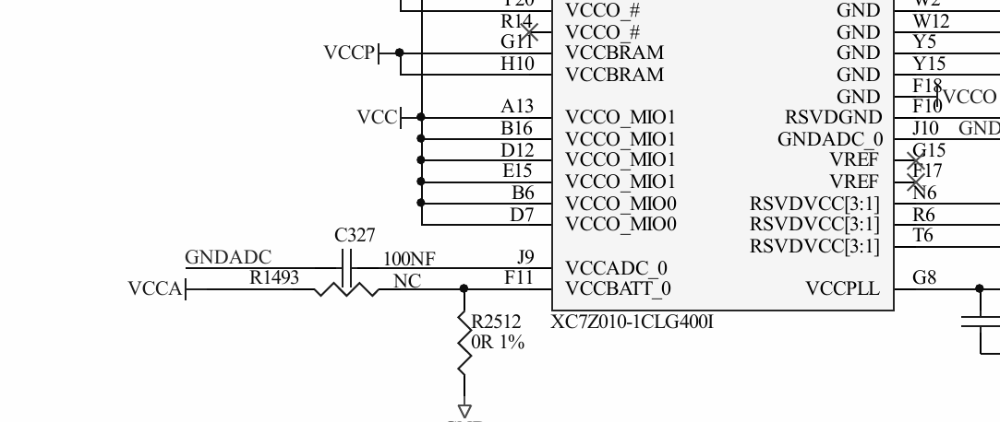
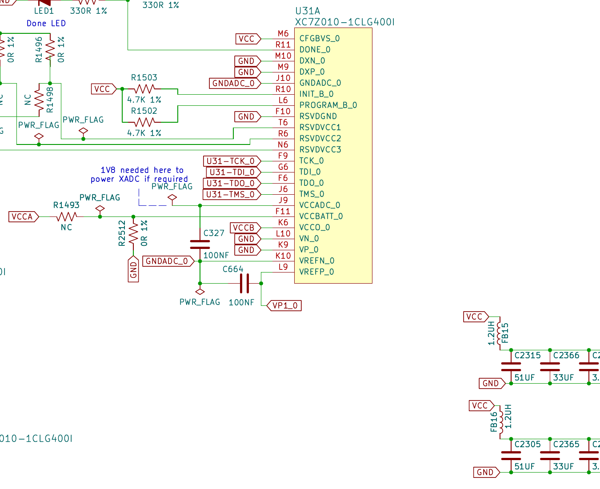

# Lab 00 — Board Bring-up

Goal: prove that the toolchain, JTAG cable and EBAZ4205 board work **before** any RTL is written, so that later failures can be isolated to the design instead of the setup.

## Lab Structure

```
lab00_bringup/
├── README.md                                   # this bring-up log
└── docs/
    ├── xadc_vccadc_vendor_schematic.png        # XADC supply pins, vendor schematic
    └── xadc_vccadc_kicad_schematic.png         # same area, community KiCad redraw
```

## Summary

| Check | Result | Status |
|---|---|---|
| Vivado part available (`xc7z010clg400`) | Found in Default Part list | ✅ |
| JTAG cable detected | Digilent-compatible (JTAG-SMT2 type) | ✅ |
| JTAG chain | `arm_dap_0` (index 0), `xc7z010_1` (index 1) | ✅ |
| Reconnect test (disconnect / connect / re-open) | Same chain detected | ✅ |
| Device identity via IDCODE | `0x13722093` → `xc7z010` | ✅ |
| PL configuration state | Unconfigured (`DONE = 0`), as expected | ✅ |
| XADC readout | All channels 0 — XADC unpowered on this board | ⚠️ board limitation |
| Chip marking (package / speed / temp grade) | pending | ⏳ |
| Tool versions (Vivado, Icarus, GTKWave) | pending | ⏳ |
| USB-UART loopback (CH343P) | pending | ⏳ |
| PS UART J7 | pending | ⏳ |
| Simulation toolchain RED test (`tb_blink_core` without RTL) | pending | ⏳ |

## 1. Environment

| Item | Value |
|---|---|
| Host OS | Windows 11 |
| Vivado | pending (`vivado -version`) |
| Icarus Verilog / GTKWave | pending (`iverilog -V`, `gtkwave --version`) |
| Git remote | `github.com/Ygbzyem/ebaz4205-fpga-labs` (3 initial commits pushed) |

## 2. Board

| Item | Value |
|---|---|
| Board | EBAZ4205 (former Ebit E9+ miner control board) |
| Power | 12 V adapter on J4, Schottky diode D24 fitted |
| Boot select | Modified for SD boot (no SD card inserted during this lab) |
| JTAG header | J8 |
| PS UART | J7, CH343P USB-UART |
| PL oscillator | X5, 50 MHz |
| Schematic reference | [xjtuecho/EBAZ4205](https://github.com/xjtuecho/EBAZ4205) (MIT) |

### Device resources (Vivado part database, `xc7z010clg400`)

| Resource | Count |
|---|---|
| Package pins | 400 |
| Available IOBs | 100 |
| LUTs | 17,600 |
| Flip-flops | 35,200 |
| Block RAM (36 Kb) | 60 |
| DSP slices | 80 |

## 3. JTAG

Commands (Vivado Tcl console):

```tcl
open_hw_manager
get_hw_servers                 ;# localhost:3121 already connected
open_hw_target
get_hw_devices
report_property [get_hw_devices xc7z010_1]
```

Note: running `connect_hw_server` while a connection already exists gives
`[Labtoolstcl 44-586] Disconnect server connection ... before making a new one`.
Use the existing connection, or `disconnect_hw_server localhost:3121` first.

### Chain

| Index | Device | IR length | Role |
|---|---|---|---|
| 0 | `arm_dap_0` | 4 | ARM Debug Access Port (PS, Cortex-A9) |
| 1 | `xc7z010_1` | 6 (read from `IR_LENGTH`) | PL TAP — bitstream target |

### Device properties of `xc7z010_1`

| Property | Value | Meaning |
|---|---|---|
| `IDCODE_HEX` | `13722093` | [31:28] version = 1, [27:12] part = `0x3722` (7Z010), [11:1] manufacturer = `0x049` (Xilinx), [0] = 1 |
| `MASK_HEX` | `0FFFFFFF` | Version bits ignored when matching |
| `PART` | `xc7z010` | IDCODE does **not** encode package or speed grade → read the chip marking |
| `REGISTER.IR` | `000001` | `DONE = 0`, `INIT_COMPLETE = 0` → PL not configured |
| `REGISTER.USERCODE` | `ffffffff` | No user design loaded |
| `PROGRAM.IS_AES_PROGRAMMED` / `IS_RSA_PROGRAMMED` | `0` / `0` | No eFUSE security lock |
| `IS_SYSMON_SUPPORTED` | `1` | Device has an XADC block |

## 4. XADC (System Monitor)

### Observation

```tcl
refresh_hw_sysmon [get_hw_sysmons]
get_property TEMPERATURE [get_hw_sysmons]   ;# -273.1
get_property VCCINT      [get_hw_sysmons]   ;# 0.000
get_property VCCAUX      [get_hw_sysmons]   ;# 0.000
get_property VCCPINT     [get_hw_sysmons]   ;# 0.000
```

All voltage channels read 0.000 V and the temperature reads -273.1 °C, which is the conversion of an ADC code of 0. The values stay at 0 after an explicit `refresh_hw_sysmon`, so this is not a stale-cache issue.

### Root cause (schematic)

| Pin (ball) | Connection on EBAZ4205 | Expected for a working XADC |
|---|---|---|
| `VCCADC_0` (J9) | Only a 100 nF capacitor (C327) to `GNDADC_0`; **no supply** | Filtered 1.8 V |
| `GNDADC_0` (J10) | `GNDADC` net | Analog ground |
| `VCCBATT_0` (F11) | To GND via R2512 (0 Ω); R1493 from VCCA not fitted (NC) | Battery or GND if unused |
| `VREFN_0` (K10) / `VREFP_0` (L9) | `VREFN_0` to `GNDADC_0`; `VREFP_0` decoupled by C664, its optional external 1.25 V reference circuit is marked "typically not fitted" (KiCad redraw) | Reference configuration per UG480 |

The community KiCad redraw of the same sheet carries the note *"1V8 needed here to power XADC if required"* next to `VCCADC_0`.





### Conclusion

The XADC is **not powered** on this board as shipped, so it cannot be used for temperature or supply monitoring. This matches the all-zero readout. Supply voltages, if needed, must be measured with a multimeter at the board test points. Re-reading the XADC after Lab 01 programs a bitstream is expected to give the same result (to be recorded then).

## 5. UART

| Test | Setup | Result |
|---|---|---|
| Adapter loopback | CH343P TX shorted to RX, Tera Term 115200 8N1 | pending |
| PS UART J7 | TX↔RX crossed, GND, no VCC, 3.3 V level | pending (no output expected without an SD card) |

## 6. Simulation Toolchain

```sh
cd labs/lab01_blink
mkdir -p build
iverilog -g2001 -Wall -o build/sim tb/tb_blink_core.v
```

Expected: `Unknown module type: blink_core` (TDD RED state before Lab 01 RTL exists). Result: pending.

## Issues and Lessons

| Issue | Cause | Fix |
|---|---|---|
| `Labtoolstcl 44-586` on `connect_hw_server` | hw_server connection already open (GUI auto-connect) | Reuse the connection or disconnect first |
| XADC reads 0 / -273.1 °C | `VCCADC_0` has no supply on this board | Documented as a board limitation |
