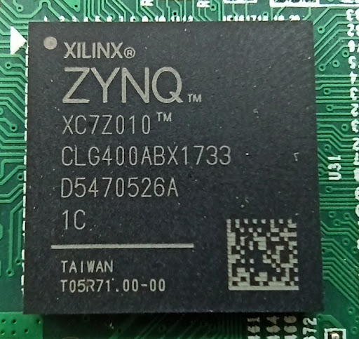
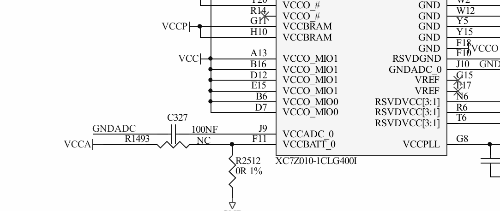
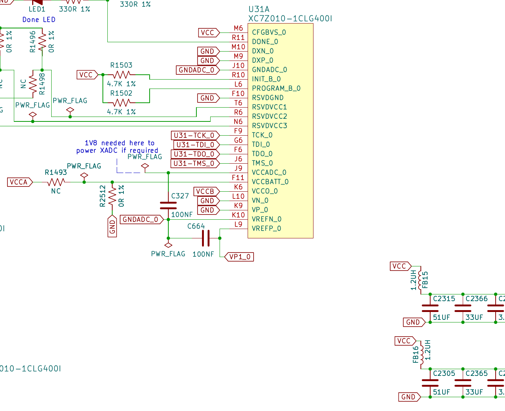

# Lab 00 — Bring-up board

[English](README.md) | [Tiếng Việt](README.vi.md)

**Trạng thái: hoàn thành** — đã xác nhận JTAG, danh tính chip, adapter UART và toolchain mô phỏng; XADC được ghi nhận là giới hạn của board.

Mục tiêu: chứng minh toolchain, cáp JTAG và board EBAZ4205 hoạt động **trước khi** viết dòng RTL nào, để các lỗi về sau có thể khoanh vùng vào thiết kế thay vì vào khâu chuẩn bị.

## Cấu trúc lab

```
lab00_bringup/
├── README.md / README.vi.md                     # log bring-up này
└── docs/
    ├── zynq_chip_marking.png                   # ảnh chữ in trên U31
    ├── xadc_vccadc_vendor_schematic.png        # chân nguồn XADC, schematic gốc
    └── xadc_vccadc_kicad_schematic.png         # cùng vùng đó, bản vẽ lại KiCad của cộng đồng
```

## Tổng kết

| Kiểm tra | Kết quả | Trạng thái |
|---|---|---|
| Vivado có part (`xc7z010clg400`) | Có trong danh sách Default Part | ✅ |
| Nhận cáp JTAG | Loại tương thích Digilent (JTAG-SMT2) | ✅ |
| JTAG chain | `arm_dap_0` (index 0), `xc7z010_1` (index 1) | ✅ |
| Thử kết nối lại (ngắt / kết nối / mở lại) | Thấy lại đúng chain đó | ✅ |
| Danh tính chip qua IDCODE | `0x13722093` → `xc7z010` | ✅ |
| Trạng thái cấu hình PL | Chưa cấu hình (`DONE = 0`), đúng như kỳ vọng | ✅ |
| Đọc XADC | Mọi kênh bằng 0 — XADC không có nguồn trên board này | ⚠️ giới hạn của board |
| Chữ in trên chip (vỏ / speed / dải nhiệt) | `XC7Z010` `CLG400` `1C` → `xc7z010clg400-1`, commercial | ✅ |
| Version Vivado | v2020.2 (64-bit), SW Build 3064766 | ✅ |
| Git | 2.55.0.windows.2 | ✅ |
| Icarus Verilog / GTKWave trên Windows | Chưa cài — bộ cài bị SmartScreen cảnh báo *Malicious file*; sẽ cài từ gói Ubuntu qua WSL | ⏭️ hoãn |
| Loopback USB-UART (CH343P) | Ký tự gõ vào được hiện lại | ✅ |
| UART của PS ở J7 | Không có output, gõ không hiện — đúng như kỳ vọng (boot từ SD, không cắm thẻ) | ✅ (đúng kỳ vọng) |
| RED test toolchain mô phỏng (`tb_blink_core` khi chưa có RTL) | Vivado xsim: `Module <blink_core> not found`, đúng như kỳ vọng | ✅ |

## 1. Môi trường

| Mục | Giá trị |
|---|---|
| Hệ điều hành | Windows 11 |
| Vivado | v2020.2 (64-bit), SW Build 3064766, IP Build 3064653 |
| Bộ mô phỏng Vivado | xsim 2020.2 (`xvlog` / `xelab` / `xsim`, đã có sẵn trong PATH) |
| Icarus Verilog / GTKWave | Hoãn: bộ cài Windows bị SmartScreen chặn; kế hoạch: `apt install iverilog gtkwave` trong WSL Ubuntu |
| Git | 2.55.0.windows.2 |
| Git remote | `github.com/Ygbzyem/ebaz4205-fpga-labs` qua HTTPS (push được; không dùng SSH) |

## 2. Board

| Mục | Giá trị |
|---|---|
| Board | EBAZ4205 (vốn là board điều khiển máy đào Ebit E9+) |
| Nguồn | Adapter 12 V vào J4, đã hàn diode Schottky D24 |
| Chế độ boot | Đã chỉnh sang boot từ SD (trong lab này không cắm thẻ) |
| Header JTAG | J8 |
| UART của PS | J7, USB-UART CH343P |
| Thạch anh PL | X5, 50 MHz |
| Schematic tham chiếu | [xjtuecho/EBAZ4205](https://github.com/xjtuecho/EBAZ4205) (MIT) |

### Chữ in trên chip (U31)

| Dòng | Chữ in | Ý nghĩa |
|---|---|---|
| Thiết bị | `XC7Z010` | Zynq-7010 |
| Vỏ | `CLG400...` | BGA CLG400 |
| Grade | `1C` | Speed grade -1, dải nhiệt độ commercial |
| Part trong Vivado | `xc7z010clg400-1` | Dùng cho mọi lab |

Schematic gốc ghi U31 là `XC7Z010-1CLG400I` (industrial), nhưng chip hàn trên board là loại commercial (`C`). Chữ in trên chip là nguồn đáng tin nhất.



### Tài nguyên chip (cơ sở dữ liệu part của Vivado, `xc7z010clg400-1`)

| Tài nguyên | Số lượng |
|---|---|
| Chân vỏ | 400 |
| IOB dùng được | 100 |
| LUT | 17,600 |
| Flip-flop | 35,200 |
| Block RAM (36 Kb) | 60 |
| DSP slice | 80 |

## 3. JTAG

Lệnh (Tcl console của Vivado):

```tcl
open_hw_manager
get_hw_servers                 ;# localhost:3121 đã kết nối sẵn
open_hw_target
get_hw_devices
report_property [get_hw_devices xc7z010_1]
```

Lưu ý: chạy `connect_hw_server` khi đã có kết nối sẽ báo
`[Labtoolstcl 44-586] Disconnect server connection ... before making a new one`.
Dùng luôn kết nối đang có, hoặc chạy `disconnect_hw_server localhost:3121` trước.

### Chain

| Index | Thiết bị | Độ dài IR | Vai trò |
|---|---|---|---|
| 0 | `arm_dap_0` | 4 | ARM Debug Access Port (PS, Cortex-A9) |
| 1 | `xc7z010_1` | 6 (đọc từ `IR_LENGTH`) | TAP của PL — nơi nạp bitstream |

### Thuộc tính của `xc7z010_1`

| Thuộc tính | Giá trị | Ý nghĩa |
|---|---|---|
| `IDCODE_HEX` | `13722093` | [31:28] version = 1, [27:12] part = `0x3722` (7Z010), [11:1] nhà sản xuất = `0x049` (Xilinx), [0] = 1 |
| `MASK_HEX` | `0FFFFFFF` | Bỏ qua các bit version khi so khớp |
| `PART` | `xc7z010` | IDCODE **không** chứa vỏ và speed grade → phải đọc chữ in trên chip |
| `REGISTER.IR` | `000001` | `DONE = 0`, `INIT_COMPLETE = 0` → PL chưa được cấu hình |
| `REGISTER.USERCODE` | `ffffffff` | Chưa nạp thiết kế nào |
| `PROGRAM.IS_AES_PROGRAMMED` / `IS_RSA_PROGRAMMED` | `0` / `0` | Không khoá bảo mật eFUSE |
| `IS_SYSMON_SUPPORTED` | `1` | Chip có khối XADC |

## 4. XADC (System Monitor)

### Quan sát

```tcl
refresh_hw_sysmon [get_hw_sysmons]
get_property TEMPERATURE [get_hw_sysmons]   ;# -273.1
get_property VCCINT      [get_hw_sysmons]   ;# 0.000
get_property VCCAUX      [get_hw_sysmons]   ;# 0.000
get_property VCCPINT     [get_hw_sysmons]   ;# 0.000
```

Mọi kênh điện áp đọc ra 0.000 V và nhiệt độ đọc ra -273.1 °C, chính là kết quả đổi đơn vị của mã ADC bằng 0. Giá trị vẫn bằng 0 sau khi chạy `refresh_hw_sysmon`, nên không phải do dữ liệu cũ chưa cập nhật.

### Nguyên nhân (schematic)

| Chân (ball) | Nối gì trên EBAZ4205 | Cần gì để XADC chạy |
|---|---|---|
| `VCCADC_0` (J9) | Chỉ có tụ 100 nF (C327) xuống `GNDADC_0`; **không có nguồn** | Nguồn 1.8 V đã lọc |
| `GNDADC_0` (J10) | Net `GNDADC` | Mass analog |
| `VCCBATT_0` (F11) | Xuống GND qua R2512 (0 Ω); R1493 từ VCCA không hàn (NC) | Pin, hoặc GND nếu không dùng |
| `VREFN_0` (K10) / `VREFP_0` (L9) | `VREFN_0` nối `GNDADC_0`; `VREFP_0` có tụ C664, mạch tạo điện áp tham chiếu ngoài 1.25 V được ghi "typically not fitted" (bản KiCad) | Cấu hình điện áp tham chiếu theo UG480 |

Bản vẽ lại KiCad của cộng đồng cho cùng trang có ghi chú *"1V8 needed here to power XADC if required"* ngay cạnh `VCCADC_0`.





### Kết luận

XADC **không được cấp nguồn** trên board nguyên bản, nên không dùng được để đo nhiệt độ hay điện áp nguồn. Điều này khớp với việc mọi giá trị đọc ra đều bằng 0. Nếu cần đo điện áp nguồn thì phải dùng đồng hồ vạn năng tại các điểm đo trên board. Đọc lại XADC sau khi Lab 01 nạp bitstream dự kiến vẫn ra kết quả như cũ (sẽ ghi lại khi đó).

## 5. UART

| Bài thử | Cách nối | Kết quả |
|---|---|---|
| Loopback adapter | Chập TX với RX của CH343P, 115200 8N1 | ✅ Ký tự gõ vào được hiện lại → driver, cổng COM và adapter đều ổn |
| UART của PS ở J7 | TX↔RX nối chéo, GND, không nối VCC, PuTTY 115200 8N1 | Trống, gõ không hiện. Đúng như kỳ vọng: board boot từ SD mà không có thẻ, nên không có phần mềm nào chạy trên PS để điều khiển UART. Sẽ thử lại ở Lab 09 (bare-metal trên PS) |

## 6. Toolchain mô phỏng

RED test theo TDD: testbench của Lab 01 phải elaborate thất bại khi chưa có `blink_core`.

Vivado xsim (`cmd` của Windows):

```bat
cd C:\GitHub\ebaz4205-fpga-labs\labs\lab01_blink
xvlog tb\tb_blink_core.v
xelab tb_blink_core -s tb_sim
```

Kết quả:

```
INFO: [VRFC 10-311] analyzing module tb_blink_core
ERROR: [VRFC 10-2063] Module <blink_core> not found while processing module instance <dut> [.../tb/tb_blink_core.v:42]
ERROR: [XSIM 43-3322] Static elaboration of top level Verilog design unit(s) in library work failed.
```

✅ Đúng trạng thái RED như kỳ vọng. `xvlog` và `xelab` đã có sẵn trong PATH nên không cần chạy `settings64.bat`. Các file sinh ra (`xsim.dir/`, `*.log`, `*.pb`) đều đã có trong `.gitignore`.

Icarus Verilog (dự kiến, WSL Ubuntu):

```sh
cd /mnt/c/GitHub/ebaz4205-fpga-labs/labs/lab01_blink
mkdir -p build
iverilog -g2001 -Wall -o build/sim tb/tb_blink_core.v   # kỳ vọng: Unknown module type: blink_core
```

## Sự cố và bài học

| Sự cố | Nguyên nhân | Cách xử lý |
|---|---|---|
| `Labtoolstcl 44-586` khi chạy `connect_hw_server` | Kết nối hw_server đã mở sẵn (GUI tự kết nối) | Dùng lại kết nối hoặc ngắt kết nối trước |
| XADC đọc ra 0 / -273.1 °C | `VCCADC_0` không có nguồn trên board này | Ghi nhận là giới hạn của board |
| Gõ `vivado -version` trong Tcl console của Vivado bị warning `Common 17-259` | Đó là lệnh hệ điều hành, không phải lệnh Tcl | Chạy trong terminal, hoặc gõ `version` trong Tcl console |
| Bộ cài Icarus cho Windows bị SmartScreen gắn cờ *Malicious file* | File nhị phân bên thứ ba chưa được xác minh | Không chạy; dùng Vivado xsim trước, gói Ubuntu qua WSL sau |
| Schematic ghi `-1CLG400I`, chip ghi `1C` | Linh kiện hàn trên board khác linh kiện vẽ trong schematic | Dùng theo chữ in trên chip (`xc7z010clg400-1`) |
