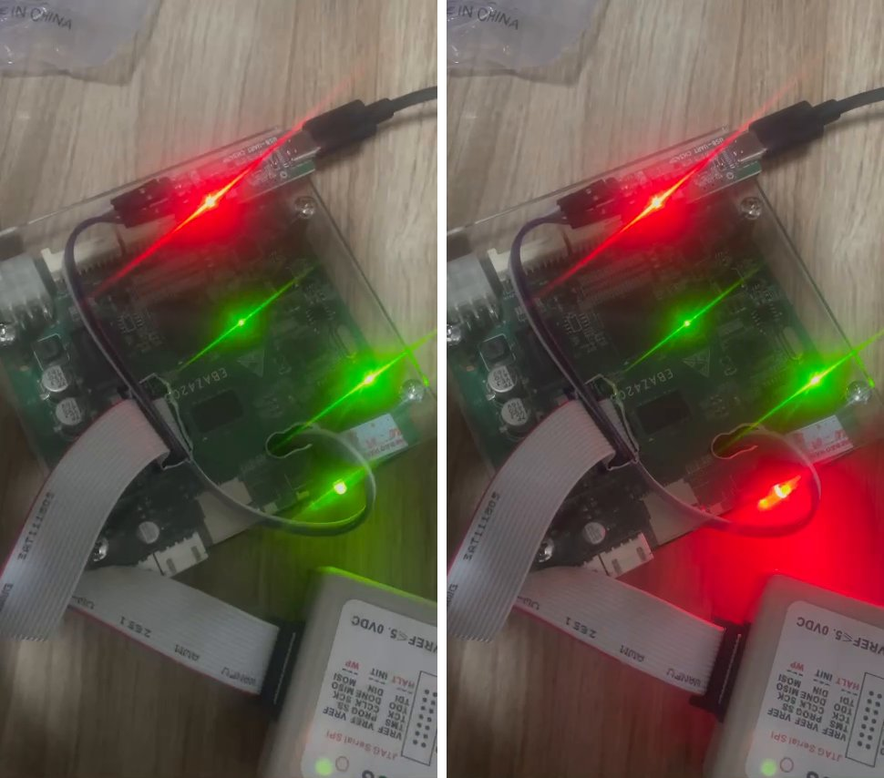

# Lab 01 — Nháy LED

[English](README.md) | [Tiếng Việt](README.vi.md)

**Trạng thái: hoàn thành** — mô phỏng PASS, đạt timing ở 50 MHz sau implementation, xác nhận cấu hình xong (`DONE = 1`), LED nháy 1 Hz trên board.

LED xanh và đỏ luân phiên ở 1 Hz (mỗi màu 0.5 s), dùng clock 50 MHz của PL. Đặc tả: [docs/spec.vi.md](docs/spec.vi.md).

## Cấu trúc lab

```
lab01_blink/
├── README.md / README.vi.md     # log này
├── docs/spec.md, spec.vi.md     # đặc tả v1.0
├── rtl/
│   ├── blink_core.v             # bộ đếm có tham số + đảo LED
│   └── lab01_top.v              # reset khi bật nguồn, ngõ ra LED active-low
├── constraints/
│   └── lab01_top.xdc            # clock N18 (20 ns), LED W13 / W14
├── tb/
│   ├── tb_blink_core.v          # tự kiểm tra, golden model, T1–T5
│   └── tb_lab01_top.v           # tự kiểm tra, độ dài POR + cực tính, T6–T7
├── scripts/
│   └── create_project.tcl       # project Vivado trong build/
└── results/
    ├── lab01_top_utilization_synth.rpt   # utilization sau synthesis
    ├── timing_summary.png                # Design Timing Summary
    └── board_blink_green_red.jpg         # board: pha xanh / pha đỏ
```

## Danh sách module

| Module | File | Vai trò |
|---|---|---|
| `blink_core` | `rtl/blink_core.v` | Bộ đếm rộng `clog2(HALF_PERIOD)` bit; đảo `led_g` sau mỗi `HALF_PERIOD` chu kỳ; `led_r = ~led_g`; reset đồng bộ tích cực mức cao |
| `lab01_top` | `rtl/lab01_top.v` | Bộ đếm reset khi bật nguồn 8 bit (giá trị đầu 0, giữ reset `POR_CYCLES` = 16 chu kỳ = 320 ns); đảo ngõ ra cho LED active-low |

## Tóm tắt thiết kế

```
clk_50m (N18) ──┬──────────────────────────────┐
                │                              ▼
          por_cnt (8 bit) ── rst ──►  blink_core (cnt: 25 bit)
                                       │ led_g        │ led_r = ~led_g
                                       ▼              ▼
                                     [NOT]          [NOT]
                                       ▼              ▼
                                led_g_n (W13)   led_r_n (W14)
```

| Mục | Giá trị |
|---|---|
| Chu kỳ đảo | `HALF_PERIOD` × 20 ns = 25 000 000 × 20 ns = 0.5 s |
| Độ rộng bộ đếm | `clog2(25 000 000)` = 25 bit (constant function, không dùng `$clog2`) |
| Reset | Đồng bộ, tích cực mức cao, tạo bên trong (board không có nút reset cho PL) |
| Cực tính LED | Active-low (anode nối VCC qua 150 Ω) |

## Kết quả mô phỏng

Vivado xsim 2020.2 (bạn chạy) và Icarus Verilog 12 (`-g2001 -Wall`, đối chiếu), cùng một RTL.

| Testbench | Tham số | Số lần kiểm tra | Số lần đảo LED | Lỗi | Kết quả |
|---|---|---|---|---|---|
| `tb_blink_core` | `HALF_PERIOD` = 2 | 48 | 18 | 0 | ✅ PASS |
| `tb_blink_core` | `HALF_PERIOD` = 5 | 100 | 18 | 0 | ✅ PASS |
| `tb_blink_core` | `HALF_PERIOD` = 16 | 293 | 16 | 0 | ✅ PASS |
| `tb_lab01_top` | `HALF_PERIOD` = 4, `POR_CYCLES` = 16 | 52 (16 trong POR) | 9 | 0 | ✅ PASS |
| `tb_lab01_top` | `HALF_PERIOD` = 2, `POR_CYCLES` = 16 | 36 (16 trong POR) | 10 | 0 | ✅ PASS |
| `tb_lab01_top` | `HALF_PERIOD` = 5, `POR_CYCLES` = 3 | 47 (3 trong POR) | 8 | 0 | ✅ PASS |

Các testbench cũng đã được thử với những thiết kế cố ý gài lỗi (đếm lệch 1, reset bất đồng bộ, không reset bộ đếm, sai cực tính LED, POR quá ngắn hoặc không có POR); trường hợp nào cũng báo `TEST FAILED`.

## Kết quả hiện thực và chạy trên board

### Utilization (sau synthesis, `results/lab01_top_utilization_synth.rpt`)

| Tài nguyên | Dùng | Có sẵn | % |
|---|---|---|---|
| Slice LUT | 36 | 17 600 | 0.20 |
| Flip-flop (toàn bộ là `FDRE`, reset đồng bộ + CE) | 31 | 35 200 | 0.09 |
| Latch | 0 | — | — |
| Block RAM / DSP | 0 / 0 | 60 / 80 | 0 |
| Bonded IOB | 3 | 100 | 3.00 |
| BUFG | 1 | 32 | 3.13 |

31 flip-flop = 25 (`cnt`) + 1 (`led_g`) + 5 (`por_cnt`). `por_cnt` khai báo 8 bit nhưng dừng ở 16, nên bit [7:5] luôn bằng 0 và bị synthesis loại bỏ — khớp với số đếm. 0 latch xác nhận RTL đồng bộ và được gán đầy đủ.

### Timing sau implementation (`results/timing_summary.png`)

| Chỉ số | Giá trị |
|---|---|
| WNS (setup) | 16.378 ns |
| TNS | 0.000 ns |
| WHS (hold) | 0.243 ns |
| THS | 0.000 ns |
| WPWS (độ rộng xung) | 9.500 ns |
| Endpoint vi phạm | 0 trên 62 |
| Thông báo của công cụ | All user specified timing constraints are met |

Đường xấu nhất dùng 20 − 16.378 = 3.622 ns trong chu kỳ 20 ns, nên thiết kế này đạt timing tới khoảng 1 / 3.622 ns ≈ 276 MHz (ước lượng; chưa tính thay đổi clock uncertainty ở tần số khác).

### Board



| Kiểm tra | Kết quả |
|---|---|
| LED6 luân phiên xanh / đỏ | ✅ quan sát được |
| Chu kỳ nháy | ✅ 1.00 s cho một chu kỳ xanh + đỏ (30 khung ở 30 fps, đo 4 chu kỳ liên tiếp trong video 5.1 s) |
| `REGISTER.IR` sau khi nạp | ✅ `110101`: `DONE` = 1, `INIT_COMPLETE` = 1, `ISC_DONE` = 1, `ISC_ENABLED` = 0 (trước khi nạp ở Lab 00: `000001`) |
| Trạng thái LED Done sau khi nạp | chưa ghi lại |

## Lỗi gặp phải trong quá trình làm

| Lần | Triệu chứng (testbench) | Nguyên nhân | Cách sửa |
|---|---|---|---|
| 1 | LED đảo ở mọi chu kỳ clock (90 lần thay vì ~18) | Không có bộ đếm; không dùng `HALF_PERIOD` | Bộ đếm quay về 0 khi đạt `HALF_PERIOD − 1` |
| 1–2 | Lỗi biên dịch ở cuối file / dòng 3 | Thiếu `endmodule`; thiếu dấu phẩy giữa các parameter | Sửa cú pháp |
| 2 | LED không bao giờ đổi | `led_g <= ~led_r; led_r <= ~led_g;` giữ nguyên trạng thái (0,1) mãi | Suy `led_r` bằng logic tổ hợp: `assign led_r = ~led_g` |
| 3 | `reg led_r cannot be driven by continuous assignment` | Port khai báo `reg` nhưng lái bằng `assign` | Đổi kiểu port thành `wire` |
| 3 | `led_g_n = x` ngay từ chu kỳ đầu | `led_g_n` bị lái bởi lõi **và** bởi `assign led_g_n = ~led_g_n` (nhiều nguồn lái + vòng tổ hợp) | Thêm dây trung gian `led_g`, `led_r`, đảo một lần ở top |
| 4 | 2 lỗi: LED bị xoá trước cạnh clock khi `rst` lên | Reset bất đồng bộ (`or posedge rst`) | Reset đồng bộ (chỉ `always @(posedge clk)`) |

## Lệnh

```bat
:: Windows (PowerShell: chạy trước  $env:Path += ";C:\Xilinx\Vivado\2020.2\bin")
cd C:\GitHub\ebaz4205-fpga-labs\labs\lab01_blink
xvlog tb\tb_blink_core.v rtl\blink_core.v
xelab tb_blink_core -s tb_core
xsim tb_core -R
xvlog tb\tb_lab01_top.v rtl\lab01_top.v rtl\blink_core.v
xelab tb_lab01_top -s tb_top
xsim tb_top -R
```
