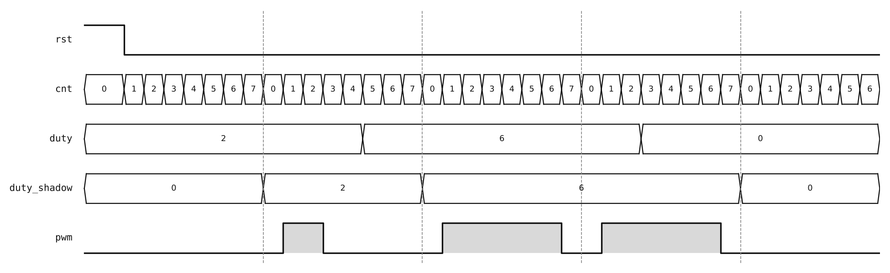
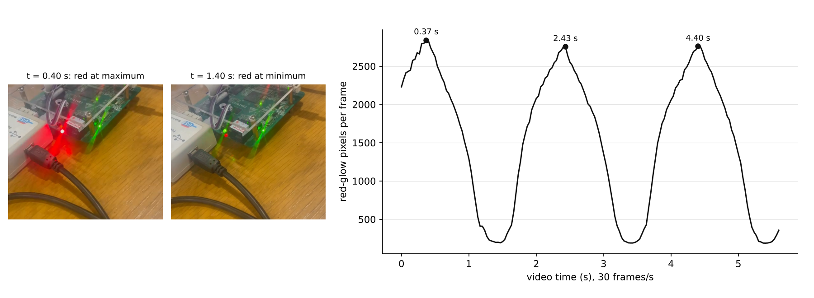

# Lab 02 — PWM Breathing LED

[English](README.md) | [Tiếng Việt](README.vi.md)

**Status: complete** — simulation PASS (7 parameter sets), timing met at 50 MHz, breathing measured on the board at 2.02 s per cycle (specified 1.9992 s).

The green and red LEDs fade in and out in opposite phase. Each LED is driven by an 8-bit PWM generator whose duty is captured in a shadow register at the start of every period, so a duty change never produces a shortened or lengthened pulse. Specification: [docs/spec.md](docs/spec.md) (v1.1, cycle-accurate). Full report: [docs/lab02_report_en.docx](docs/lab02_report_en.docx) / [docs/lab02_report_vi.docx](docs/lab02_report_vi.docx).

## Lab Structure

```
lab02_pwm_breathing/
├── README.md / README.vi.md        # this log
├── docs/
│   ├── spec.md, spec.vi.md         # specification v1.1
│   ├── lab02_report_en.docx        # lab report (English)
│   ├── lab02_report_vi.docx        # lab report (Vietnamese)
│   └── lab02_references_csl.json   # references for Zotero import
├── rtl/
│   ├── por_gen.v                   # power-on reset (also reused in Lab 03)
│   ├── pwm_core.v                  # W-bit PWM with shadow-registered duty
│   ├── breath_ctrl.v               # triangle duty ramp
│   └── lab02_top.v                 # wiring, complementary duty, active-low outputs
├── constraints/
│   └── lab02_top.xdc               # N18 clock (20 ns), W13 / W14 LEDs
├── tb/
│   ├── tb_pwm_core.v               # T1–T3: duty values, mid-period change, reset
│   ├── tb_breath_ctrl.v            # T4: ramp, step timing, turn-around
│   └── tb_lab02_top.v              # T5: pins vs. full model, green + red = 255
└── results/
    ├── lab02_top_utilization_synth.rpt   # post-synthesis utilization
    ├── timing_summary.png                # Design Timing Summary
    ├── pwm_core_waveform.png             # simulated pwm_core, W = 3
    ├── board_breathing_measurement.png   # video frames and brightness curve
    └── tb_lab02_top_xsim.log             # xsim run of the top-level testbench
```

## Module Index

| Module | File | Role |
|---|---|---|
| `por_gen` | `rtl/por_gen.v` | Reset high for the first `POR_CYCLES` = 16 edges after configuration (register initial values) |
| `pwm_core` | `rtl/pwm_core.v` | Free-running `W`-bit counter; `duty` captured on the wrap edge; registered `pwm = (cnt < duty_shadow)` |
| `breath_ctrl` | `rtl/breath_ctrl.v` | Step counter of width `clog2(STEP_CYCLES)`; duty 0 → 255 → 0 without repeating the end values |
| `lab02_top` | `rtl/lab02_top.v` | Green duty `d`, red duty `255 − d`, outputs inverted for the active-low LEDs |

## Design Summary

```
clk_50m ─► por_gen ─ rst ─► breath_ctrl ─ d ─┬──────────► pwm_core (u_g) ─► ~ ─► led_g_n (W13)
                                             └─► 255−d ─► pwm_core (u_r) ─► ~ ─► led_r_n (W14)
```

| Item | Value |
|---|---|
| PWM frequency | 50 MHz / 2^8 = 195.3 kHz |
| Duty update | Shadow register, loaded when the counter wraps from 255 to 0 |
| Ramp step | `STEP_CYCLES` = 196 000 cycles = 3.92 ms |
| Breathing period | 2 × 255 × 196 000 × 20 ns = 1.9992 s |

## Simulation Results

Final RTL. Icarus Verilog 12 (`-g2001 -Wall`) for all runs; Vivado xsim 2020.2 for the runs marked.

| Testbench | Parameters | Checks | Simulator | Result |
|---|---|---|---|---|
| `tb_pwm_core` | W = 8 | 9 947 (37 periods) | xsim, Icarus | ✅ PASS |
| `tb_pwm_core` | W = 4 | 643 (38 periods) | Icarus | ✅ PASS |
| `tb_breath_ctrl` | W = 3, STEP = 3 | 147 | Icarus | ✅ PASS |
| `tb_breath_ctrl` | W = 8, STEP = 5 | 8 302 | Icarus | ✅ PASS |
| `tb_lab02_top` | STEP = 100, POR = 16 | 102 272 (398 periods) | xsim, Icarus | ✅ PASS |
| `tb_lab02_top` | STEP = 37, POR = 16 | 38 012 | Icarus | ✅ PASS |
| `tb_lab02_top` | STEP = 100, POR = 10 | 102 266 | Icarus | ✅ PASS |

The testbenches reported every one of nine deliberately broken designs as failed: duty captured at counter 0, no shadow register, `<=` instead of `<`, asynchronous reset, ramp step one cycle late, repeated end value, red duty not complemented, power-on reset one cycle long, inverted LED polarity.



## Implementation and Board Results

### Utilization (`results/lab02_top_utilization_synth.rpt`)

| Resource | Used | Available | Util % |
|---|---|---|---|
| Slice LUTs | 67 | 17 600 | 0.38 |
| Flip-flops (69 FDRE + 1 FDSE) | 70 | 35 200 | 0.20 |
| Latches | 0 | — | — |
| CARRY4 | 7 | — | — |
| Block RAM / DSP | 0 / 0 | 60 / 80 | 0 |
| Bonded IOB / BUFG | 3 / 1 | 100 / 32 | 3.00 / 3.13 |

70 flip-flops = 2 × (8 `cnt` + 8 `duty_shadow` + 1 `pwm`) + (18 step counter + 8 `duty` + 1 `direction`) + (8 `por_cnt` + 1 `rst`), exactly the register bits listed in the synthesis log.

### Timing after implementation (`results/timing_summary.png`)

| Metric | Value |
|---|---|
| WNS / TNS (setup) | 16.218 ns / 0.000 ns |
| WHS / THS (hold) | 0.166 ns / 0.000 ns |
| WPWS | 9.500 ns |
| Failing endpoints | 0 of 163 |
| Worst path | `breath_ctrl` step counter `cnt_reg[1]` → `cnt_reg[17]`, 3.800 ns, CARRY4 × 5 + LUT2 |

Synthesis and implementation: 0 warnings. Bitstream: DRC warning ZPS7-1 (no PS7 block in a PL-only design), no effect.

### Board



| Check | Result |
|---|---|
| Smooth fade, no flicker | ✅ observed |
| Breathing period | ✅ 2.02 s ± 0.03 s (red maxima at 0.37 s, 2.43 s, 4.40 s in a 30 fps video); specified 1.9992 s |
| Opposite phase | ✅ green brightest near the red minima |

## Issues Found During Development

| Symptom | Cause | Fix |
|---|---|---|
| Syntax errors | `;` between parameters, missing `endmodule`, misspelt `always` | Syntax |
| Testbench could not find the PWM ports | Ports named for one colour (`duty_g`, `pwm_out_g`) | Generic names `duty`, `pwm` |
| Reset stuck high in simulation | `por_cnt` and `rst` without initial values (X) | `reg [7:0] por_cnt = 0`, `output reg rst = 1'b1` |
| `rst` declared twice | `localparam rst` used as an initial value | Initial value in the port declaration |
| Sawtooth instead of triangle | No direction register | `direction` bit, turn-around at 255 and 0 |
| Green never lit (`duty range 0..0`) | Ramp output on `duty_r`, which also had an `assign` (two drivers); `duty_g` undriven | Ramp output to `duty_g` |
| Fails with `POR_CYCLES` ≠ 16 | Parameter not passed to `por_gen` | `#(.POR_CYCLES(POR_CYCLES))` |
| `Module <por_gen> not found` | `xvlog` given only two files; stale modules in the work library | List every source file in each compile |

## Commands

```bat
:: Windows (PowerShell: first run  $env:Path += ";C:\Xilinx\Vivado\2020.2\bin")
cd C:\GitHub\ebaz4205-fpga-labs\labs\lab02_pwm_breathing
xvlog tb\tb_pwm_core.v rtl\pwm_core.v
xelab tb_pwm_core -s tb_pwm
xsim tb_pwm -R
xvlog tb\tb_breath_ctrl.v rtl\breath_ctrl.v
xelab tb_breath_ctrl -s tb_breath
xsim tb_breath -R
xvlog tb\tb_lab02_top.v rtl\lab02_top.v rtl\por_gen.v rtl\breath_ctrl.v rtl\pwm_core.v
xelab tb_lab02_top -s tb_lab02
xsim tb_lab02 -R
```
