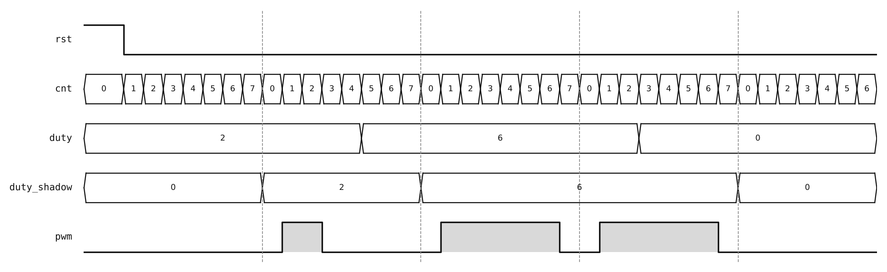
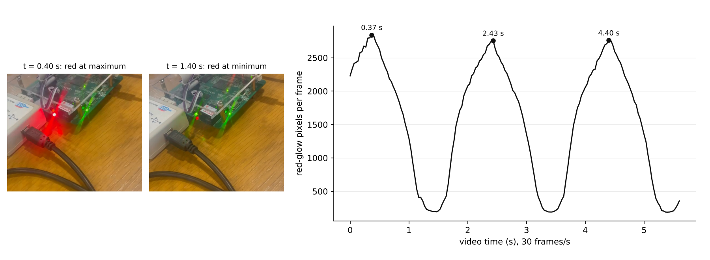

# Lab 02 — LED thở bằng PWM

[English](README.md) | [Tiếng Việt](README.vi.md)

**Trạng thái: hoàn thành** — mô phỏng PASS (7 bộ tham số), đạt timing ở 50 MHz, chu kỳ thở đo trên board là 2.02 s (đặc tả 1.9992 s).

LED xanh và đỏ sáng dần rồi tối dần, ngược pha nhau. Mỗi LED được lái bởi một bộ PWM 8 bit; duty được chốt vào thanh ghi shadow ở đầu mỗi chu kỳ PWM, nên khi duty đổi không bao giờ xuất hiện xung bị cắt ngắn hay kéo dài. Đặc tả: [docs/spec.vi.md](docs/spec.vi.md) (v1.1, chính xác theo chu kỳ). Báo cáo đầy đủ: [docs/lab02_report_vi.docx](docs/lab02_report_vi.docx) / [docs/lab02_report_en.docx](docs/lab02_report_en.docx).

## Cấu trúc lab

```
lab02_pwm_breathing/
├── README.md / README.vi.md        # log này
├── docs/
│   ├── spec.md, spec.vi.md         # đặc tả v1.1
│   ├── lab02_report_en.docx        # báo cáo (tiếng Anh)
│   ├── lab02_report_vi.docx        # báo cáo (tiếng Việt)
│   └── lab02_references_csl.json   # tài liệu tham khảo để import vào Zotero
├── rtl/
│   ├── por_gen.v                   # reset khi bật nguồn (dùng lại ở Lab 03)
│   ├── pwm_core.v                  # PWM W bit, duty qua thanh ghi shadow
│   ├── breath_ctrl.v               # duty tăng giảm hình tam giác
│   └── lab02_top.v                 # nối dây, duty bù, ngõ ra active-low
├── constraints/
│   └── lab02_top.xdc               # clock N18 (20 ns), LED W13 / W14
├── tb/
│   ├── tb_pwm_core.v               # T1–T3: các giá trị duty, đổi giữa chu kỳ, reset
│   ├── tb_breath_ctrl.v            # T4: dốc tăng giảm, thời gian bước, điểm đổi chiều
│   └── tb_lab02_top.v              # T5: chân ra so với mô hình đầy đủ, xanh + đỏ = 255
└── results/
    ├── lab02_top_utilization_synth.rpt   # utilization sau synthesis
    ├── timing_summary.png                # Design Timing Summary
    ├── pwm_core_waveform.png             # mô phỏng pwm_core, W = 3
    ├── board_breathing_measurement.png   # khung hình video và đường độ sáng
    └── tb_lab02_top_xsim.log             # log xsim của testbench top
```

## Danh sách module

| Module | File | Vai trò |
|---|---|---|
| `por_gen` | `rtl/por_gen.v` | Giữ reset mức cao trong `POR_CYCLES` = 16 cạnh đầu sau khi nạp cấu hình (dùng giá trị khởi tạo của thanh ghi) |
| `pwm_core` | `rtl/pwm_core.v` | Bộ đếm `W` bit chạy tự do; chốt `duty` ở cạnh bộ đếm quay vòng; `pwm = (cnt < duty_shadow)` có thanh ghi |
| `breath_ctrl` | `rtl/breath_ctrl.v` | Bộ đếm bước rộng `clog2(STEP_CYCLES)` bit; duty 0 → 255 → 0, không lặp lại giá trị ở hai đầu |
| `lab02_top` | `rtl/lab02_top.v` | Duty xanh `d`, duty đỏ `255 − d`, đảo ngõ ra cho LED active-low |

## Tóm tắt thiết kế

```
clk_50m ─► por_gen ─ rst ─► breath_ctrl ─ d ─┬──────────► pwm_core (u_g) ─► ~ ─► led_g_n (W13)
                                             └─► 255−d ─► pwm_core (u_r) ─► ~ ─► led_r_n (W14)
```

| Mục | Giá trị |
|---|---|
| Tần số PWM | 50 MHz / 2^8 = 195.3 kHz |
| Cập nhật duty | Thanh ghi shadow, nạp khi bộ đếm quay vòng từ 255 về 0 |
| Bước dốc | `STEP_CYCLES` = 196 000 chu kỳ = 3.92 ms |
| Chu kỳ thở | 2 × 255 × 196 000 × 20 ns = 1.9992 s |

## Kết quả mô phỏng

RTL cuối cùng. Icarus Verilog 12 (`-g2001 -Wall`) cho mọi lần chạy; Vivado xsim 2020.2 cho các lần chạy có ghi.

| Testbench | Tham số | Số lần so sánh | Trình mô phỏng | Kết quả |
|---|---|---|---|---|
| `tb_pwm_core` | W = 8 | 9 947 (37 chu kỳ PWM) | xsim, Icarus | ✅ PASS |
| `tb_pwm_core` | W = 4 | 643 (38 chu kỳ PWM) | Icarus | ✅ PASS |
| `tb_breath_ctrl` | W = 3, STEP = 3 | 147 | Icarus | ✅ PASS |
| `tb_breath_ctrl` | W = 8, STEP = 5 | 8 302 | Icarus | ✅ PASS |
| `tb_lab02_top` | STEP = 100, POR = 16 | 102 272 (398 chu kỳ PWM) | xsim, Icarus | ✅ PASS |
| `tb_lab02_top` | STEP = 37, POR = 16 | 38 012 | Icarus | ✅ PASS |
| `tb_lab02_top` | STEP = 100, POR = 10 | 102 266 | Icarus | ✅ PASS |

Các testbench báo FAIL với cả chín thiết kế cố tình làm hỏng: chốt duty khi bộ đếm bằng 0, không có thanh ghi shadow, dùng `<=` thay cho `<`, reset bất đồng bộ, bước dốc trễ một chu kỳ, lặp giá trị ở đầu dốc, duty đỏ không lấy bù, reset khi bật nguồn chỉ dài một chu kỳ, đảo ngược cực tính LED.



## Kết quả implementation và trên board

### Utilization (`results/lab02_top_utilization_synth.rpt`)

| Tài nguyên | Đã dùng | Có sẵn | Tỉ lệ % |
|---|---|---|---|
| Slice LUT | 67 | 17 600 | 0.38 |
| Flip-flop (69 FDRE + 1 FDSE) | 70 | 35 200 | 0.20 |
| Latch | 0 | — | — |
| CARRY4 | 7 | — | — |
| Block RAM / DSP | 0 / 0 | 60 / 80 | 0 |
| Bonded IOB / BUFG | 3 / 1 | 100 / 32 | 3.00 / 3.13 |

70 flip-flop = 2 × (8 `cnt` + 8 `duty_shadow` + 1 `pwm`) + (18 bộ đếm bước + 8 `duty` + 1 `direction`) + (8 `por_cnt` + 1 `rst`), đúng bằng số bit thanh ghi trong log synthesis.

### Timing sau implementation (`results/timing_summary.png`)

| Chỉ số | Giá trị |
|---|---|
| WNS / TNS (setup) | 16.218 ns / 0.000 ns |
| WHS / THS (hold) | 0.166 ns / 0.000 ns |
| WPWS | 9.500 ns |
| Endpoint vi phạm | 0 / 163 |
| Đường chậm nhất | Bộ đếm bước của `breath_ctrl` `cnt_reg[1]` → `cnt_reg[17]`, 3.800 ns, CARRY4 × 5 + LUT2 |

Synthesis và implementation: 0 warning. Bitstream: DRC warning ZPS7-1 (thiết kế chỉ dùng PL nên không có khối PS7), không ảnh hưởng.

### Trên board



| Kiểm tra | Kết quả |
|---|---|
| Sáng tối mượt, không nháy | ✅ quan sát được |
| Chu kỳ thở | ✅ 2.02 s ± 0.03 s (đỉnh đỏ ở 0.37 s, 2.43 s, 4.40 s trong video 30 fps); đặc tả 1.9992 s |
| Ngược pha | ✅ xanh sáng nhất gần lúc đỏ tối nhất |

## Các lỗi gặp khi phát triển

| Triệu chứng | Nguyên nhân | Cách sửa |
|---|---|---|
| Lỗi cú pháp | `;` giữa các parameter, thiếu `endmodule`, gõ sai `always` | Sửa cú pháp |
| Testbench không tìm thấy port PWM | Port đặt tên theo một màu (`duty_g`, `pwm_out_g`) | Tên chung `duty`, `pwm` |
| Reset kẹt mức cao trong mô phỏng | `por_cnt` và `rst` không có giá trị khởi tạo (X) | `reg [7:0] por_cnt = 0`, `output reg rst = 1'b1` |
| `rst` khai báo hai lần | Dùng `localparam rst` làm giá trị khởi tạo | Đặt giá trị khởi tạo ngay ở khai báo port |
| Ra răng cưa thay vì tam giác | Thiếu thanh ghi chiều | Bit `direction`, đổi chiều ở 255 và 0 |
| LED xanh không bao giờ sáng (`duty range 0..0`) | Ngõ ra dốc nối vào `duty_r`, dây này còn có `assign` (hai nguồn lái); `duty_g` không có nguồn lái | Nối ngõ ra dốc vào `duty_g` |
| Fail khi `POR_CYCLES` ≠ 16 | Không truyền parameter xuống `por_gen` | `#(.POR_CYCLES(POR_CYCLES))` |
| `Module <por_gen> not found` | `xvlog` chỉ được đưa hai file; thư viện work còn module cũ | Liệt kê đủ mọi file nguồn ở mỗi lần biên dịch |

## Lệnh chạy

```bat
:: Windows (PowerShell: chạy trước  $env:Path += ";C:\Xilinx\Vivado\2020.2\bin")
cd C:\GitHub\ebaz4205-fpga-labs\labs\lab02_pwm_breathing
xvlog tb\tb_pwm_core.v rtl\pwm_core.v
xelab tb_pwm_core -s tb_pwm
xsim tb_pwm -R
xvlog tb\tb_breath_ctrl.v rtl\breath_ctrl.v
xelab tb_breath_ctrl -s tb_breath
xsim tb_breath -R
xvlog tb\tb_lab02_top.v rtl\lab02_top.v rtl\por_gen.v rtl\breath_ctrl.v rtl\pwm_core.v
xelab tb_lab02_top -s tb_lab02
xsim tb_lab02 -R
```
