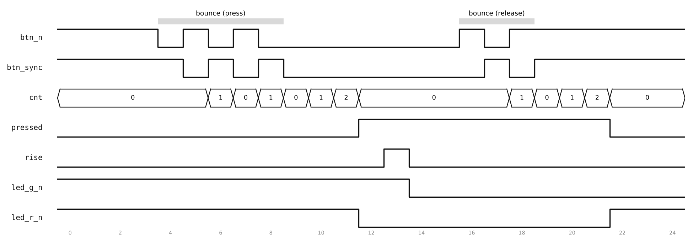

# Lab 03 — External Button

[English](README.md) | [Tiếng Việt](README.vi.md)

**Status: simulation and implementation complete, board test pending** — all testbenches PASS, timing met at 50 MHz; the on-board test needs 2.0 mm jumper wires for header DATA1 (see [Board](#board)).

Every press of a push button toggles the green LED exactly once; the red LED is on while the button is held. The button signal is asynchronous and bounces, so it passes through a two-flip-flop synchronizer, a 20 ms debouncer and an edge detector before it reaches the toggle register. Specification: [docs/spec.md](docs/spec.md) (v1.1, cycle-accurate). Full report: [docs/lab03_report_en.docx](docs/lab03_report_en.docx) / [docs/lab03_report_vi.docx](docs/lab03_report_vi.docx).

## Lab Structure

```
lab03_button/
├── README.md / README.vi.md        # this log
├── docs/
│   ├── spec.md, spec.vi.md         # specification v1.1
│   ├── lab03_report_en.docx        # lab report (English)
│   ├── lab03_report_vi.docx        # lab report (Vietnamese)
│   └── lab03_references_csl.json   # references for Zotero import
├── rtl/
│   ├── por_gen.v                   # power-on reset (same as Lab 02)
│   ├── sync_2ff.v                  # 2-FF synchronizer, ASYNC_REG
│   ├── debounce.v                  # counter debouncer
│   ├── edge_detect.v               # registered rise / fall pulses
│   └── lab03_top.v                 # wiring, inversion, toggle register, active-low LEDs
├── constraints/
│   └── lab03_top.xdc               # N18 clock, A20 button with PULLUP, W13 / W14 LEDs
├── tb/
│   ├── tb_sync_2ff.v               # T1: latency, reset value
│   ├── tb_debounce.v               # T2–T3: bounce blocked, change after S samples
│   ├── tb_edge_detect.v            # T4: one-cycle pulses, none at reset release
│   └── tb_lab03_top.v              # T5: five bouncy presses → five toggles
└── results/
    ├── lab03_top_utilization_synth.rpt   # post-synthesis utilization
    ├── timing_summary.png                # Design Timing Summary
    ├── lab03_top_waveform.png            # simulated press, STABLE_CYCLES = 3
    └── tb_lab03_top_xsim.log             # xsim run of the top-level testbench
```

## Module Index

| Module | File | Role |
|---|---|---|
| `por_gen` | `rtl/por_gen.v` | Reset high for the first `POR_CYCLES` = 16 edges after configuration |
| `sync_2ff` | `rtl/sync_2ff.v` | Two flip-flops in series with `ASYNC_REG`; reset value `RST_VAL` (default 0, set to 1 in the top) |
| `debounce` | `rtl/debounce.v` | Counter of width `clog2(STABLE_CYCLES)`; `dout` takes the new level on the S-th consecutive differing sample |
| `edge_detect` | `rtl/edge_detect.v` | Registered `rise` / `fall` pulses of one cycle; `din_prev` follows `din` during reset |
| `lab03_top` | `rtl/lab03_top.v` | `pressed = debounce(~btn_sync)`, toggle `led_g` on `rise`, `led_r_n = ~pressed`, `led_g_n = ~led_g` |

## Design Summary

```
btn_n (A20, PULLUP) ─► sync_2ff ─ btn_sync ─► ~ ─► debounce ─ pressed ─┬─► edge_detect ─ rise ─► toggle ─► ~ ─► led_g_n (W13)
                       RST_VAL=1                  S = 1 000 000        └──────────────────────────────────► ~ ─► led_r_n (W14)
clk_50m ─► por_gen ─ rst ─► all registers
```

| Item | Value |
|---|---|
| Button polarity | `btn_n` active-low (pull-up, button to GND); inverted once after the synchronizer, so `pressed` = 1 means held |
| Debounce time | `STABLE_CYCLES` × 20 ns = 1 000 000 × 20 ns = 20 ms (20-bit counter) |
| Latency press → green LED | 2 (sync) + S (debounce) + 1 (edge) + 1 (toggle) edges after the last bounce |
| Button timing | `set_false_path -from [get_ports btn_n]`: the synchronizer handles the asynchronous input |



## Simulation Results

Final RTL. Icarus Verilog 12 (`-g2001 -Wall`) for all runs; the top-level run marked xsim was also run in Vivado xsim 2020.2 ([log](results/tb_lab03_top_xsim.log)).

| Testbench | Parameters | Checks | Observed | Result |
|---|---|---|---|---|
| `tb_sync_2ff` | `RST_VAL` = 0 / 1 | 51 / 51 | latency 2 edges | ✅ PASS |
| `tb_debounce` | S = 3, `RST_VAL` = 1 | 163 | 6 output changes | ✅ PASS |
| `tb_debounce` | S = 8, `RST_VAL` = 0 | 420 | 6 output changes | ✅ PASS |
| `tb_debounce` | S = 20, `RST_VAL` = 0 | 1 077 | 6 output changes | ✅ PASS |
| `tb_edge_detect` | — | 50 | 7 rise, 8 fall pulses | ✅ PASS |
| `tb_lab03_top` | S = 20, POR = 16 (xsim, Icarus) | 1 454 | 5 toggles, 5 presses | ✅ PASS |
| `tb_lab03_top` | S = 8, POR = 16 | 596 | 5 toggles, 5 presses | ✅ PASS |
| `tb_lab03_top` | S = 20, POR = 5 | 1 443 | 5 toggles, 5 presses | ✅ PASS |

The testbenches reported every one of nine deliberately broken designs as failed: asynchronous reset, one-flip-flop synchronizer, counter not cleared when the input returns, debouncer one cycle late, one cycle early, `din_prev` reset to 0, `rise` as a level, debouncer bypassed, toggle on `fall`.

## Implementation Results

### Utilization (`results/lab03_top_utilization_synth.rpt`)

| Resource | Used | Available | Util % |
|---|---|---|---|
| Slice LUTs (synthesis / placed) | 27 / 26 | 17 600 | 0.15 |
| Flip-flops (33 FDRE + 2 FDSE) | 35 | 35 200 | 0.10 |
| Latches | 0 | — | — |
| CARRY4 | 5 | — | — |
| Occupied slices (placed) | 14 | 4 400 | 0.32 |
| Bonded IOB / BUFG | 4 / 1 | 100 / 32 | 4.00 / 3.13 |

The elaborated RTL has 36 register bits (20 debounce counter + 8 `por_cnt` + 8 single bits); synthesis keeps 35. The removed register is most likely `fall`, whose output is unconnected (to be confirmed with the Tcl command below). The 2 FDSE match the two synchronizer stages that reset to 1.

### Timing after implementation (`results/timing_summary.png`)

| Metric | Value |
|---|---|
| WNS / TNS (setup) | 15.876 ns / 0.000 ns |
| WHS / THS (hold) | 0.188 ns / 0.000 ns |
| WPWS | 9.500 ns |
| Failing endpoints | 0 of 67 |
| Worst path | `debounce_inst/stable_cnt_reg[16]` → `stable_cnt_reg[18]`, 4.093 ns (route 76 %), LUT2 → LUT4 → LUT5 |

Synthesis: 0 warnings after optimization; two elaboration warnings report the unconnected `fall` port. Implementation: 0 warnings. Bitstream: DRC warning ZPS7-1 (PL-only design), no effect.

## Board

| ID | Check | Status |
|---|---|---|
| H1 | 20 presses → 20 green toggles, red LED on while held | ⏳ pending |

- The on-board button **S2** cannot be used: it is wired to A17 = **PS_MIO20** (processing system, active-high, 10 kΩ pull-down, 1 µF filter). It is kept for Lab 09. See [board/README.md](../../board/README.md).
- The external button goes to header **DATA1**, which has a **2.0 mm** pitch; 2.54 mm jumper wires do not fit.
- Planned wiring with 2.0 mm female jumper wires: button between **DATA1-5 (A20)** and **DATA1-12 (GND)**. DATA1-12 is used instead of DATA1-4 because DATA1-4 sits diagonally next to DATA1-5. Never touch DATA1-1/2 (VCC).

## Issues Found During Development

| Symptom | Cause | Fix |
|---|---|---|
| Compile errors in the leaf modules | Missing `parameter` / `localparam`, `output reg` driven by `assign`, missing `endmodule` | Syntax and port type |
| Rise pulse after reset release with input 1 | `din_prev` reset to 0 | `din_prev <= din` also in reset |
| Reset toggled every cycle | Extra branch added to the reused `por_gen` | Lab 02 version restored |
| Ports not found; wrong data path | Wire names used as port names, two edge detectors, no inversion, wrong reset values, no toggle register | Rewired as in the specification |
| No toggle, no red LED (0 of 5) | Synchronizer output on undeclared `btn_n_sync` (Vivado: INFO "assumed default net type wire"); debouncer read undriven `btn_sync` | `.q(btn_sync)` |
| `pressed` driven twice; green LED on after reset | `.rise(pressed)`; missing output inversion | `.rise(rise)`, `led_g_n = ~led_g` |
| Shared module edited for one use | `sync_2ff` default changed to 1 | Default 0; top overrides `RST_VAL = 1` |
| `xelab` errors about code no longer in the file | `xvlog` rejected the new file, stale module left in the work library | Fix the `xvlog` error first |

## Commands

```bat
:: Windows (PowerShell: first run  $env:Path += ";C:\Xilinx\Vivado\2020.2\bin")
cd C:\GitHub\ebaz4205-fpga-labs\labs\lab03_button
xvlog tb\tb_sync_2ff.v rtl\sync_2ff.v
xelab tb_sync_2ff -s tb_sync
xsim tb_sync -R
xvlog tb\tb_debounce.v rtl\debounce.v
xelab tb_debounce -s tb_deb
xsim tb_deb -R
xvlog tb\tb_edge_detect.v rtl\edge_detect.v
xelab tb_edge_detect -s tb_edge
xsim tb_edge -R
xvlog tb\tb_lab03_top.v rtl\lab03_top.v rtl\por_gen.v rtl\sync_2ff.v rtl\debounce.v rtl\edge_detect.v
xelab tb_lab03_top -s tb_lab03
xsim tb_lab03 -R
```

```tcl
# Vivado Tcl console, Synthesized Design open
get_cells -hier -filter {ASYNC_REG == TRUE}   ;# expect the two sync_2ff stages
get_cells -hier -filter {REF_NAME == FDSE}    ;# expect the same two cells
get_cells -hier -filter {NAME =~ *fall*}      ;# empty if fall was removed
```
