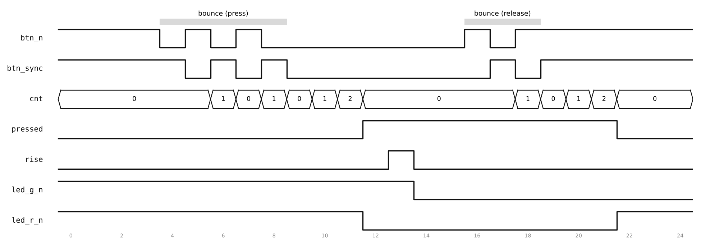

# Lab 03 — Nút nhấn bên ngoài

[English](README.md) | [Tiếng Việt](README.vi.md)

**Trạng thái: xong mô phỏng và implementation, chờ kiểm tra trên board** — mọi testbench PASS, đạt timing ở 50 MHz; phép thử trên board cần dây cắm bước 2.0 mm cho header DATA1 (xem [Trên board](#trên-board)).

Mỗi lần nhấn nút, LED xanh đảo trạng thái đúng một lần; LED đỏ sáng trong lúc giữ nút. Tín hiệu nút bất đồng bộ và có dội, nên đi qua synchronizer hai flip-flop, bộ chống dội 20 ms và bộ phát hiện cạnh trước khi tới thanh ghi đảo trạng thái. Đặc tả: [docs/spec.vi.md](docs/spec.vi.md) (v1.1, chính xác theo chu kỳ). Báo cáo đầy đủ: [docs/lab03_report_vi.docx](docs/lab03_report_vi.docx) / [docs/lab03_report_en.docx](docs/lab03_report_en.docx).

## Cấu trúc lab

```
lab03_button/
├── README.md / README.vi.md        # log này
├── docs/
│   ├── spec.md, spec.vi.md         # đặc tả v1.1
│   ├── lab03_report_en.docx        # báo cáo (tiếng Anh)
│   ├── lab03_report_vi.docx        # báo cáo (tiếng Việt)
│   └── lab03_references_csl.json   # tài liệu tham khảo để import vào Zotero
├── rtl/
│   ├── por_gen.v                   # reset khi bật nguồn (giống Lab 02)
│   ├── sync_2ff.v                  # synchronizer 2 FF, ASYNC_REG
│   ├── debounce.v                  # chống dội bằng bộ đếm
│   ├── edge_detect.v               # xung rise / fall có thanh ghi
│   └── lab03_top.v                 # nối dây, cổng đảo, thanh ghi đảo trạng thái, LED active-low
├── constraints/
│   └── lab03_top.xdc               # clock N18, nút A20 có PULLUP, LED W13 / W14
├── tb/
│   ├── tb_sync_2ff.v               # T1: độ trễ, giá trị reset
│   ├── tb_debounce.v               # T2–T3: chặn dội, đổi sau S mẫu
│   ├── tb_edge_detect.v            # T4: xung một chu kỳ, không có xung khi nhả reset
│   └── tb_lab03_top.v              # T5: năm lần nhấn có dội → năm lần đảo
└── results/
    ├── lab03_top_utilization_synth.rpt   # utilization sau synthesis
    ├── timing_summary.png                # Design Timing Summary
    ├── lab03_top_waveform.png            # mô phỏng một lần nhấn, STABLE_CYCLES = 3
    └── tb_lab03_top_xsim.log             # log xsim của testbench top
```

## Danh sách module

| Module | File | Vai trò |
|---|---|---|
| `por_gen` | `rtl/por_gen.v` | Giữ reset mức cao trong `POR_CYCLES` = 16 cạnh đầu sau khi nạp cấu hình |
| `sync_2ff` | `rtl/sync_2ff.v` | Hai flip-flop nối tiếp có `ASYNC_REG`; giá trị reset `RST_VAL` (mặc định 0, top đặt bằng 1) |
| `debounce` | `rtl/debounce.v` | Bộ đếm rộng `clog2(STABLE_CYCLES)` bit; `dout` nhận mức mới ở mẫu khác thứ S liên tiếp |
| `edge_detect` | `rtl/edge_detect.v` | Xung `rise` / `fall` một chu kỳ có thanh ghi; `din_prev` theo `din` cả khi reset |
| `lab03_top` | `rtl/lab03_top.v` | `pressed = debounce(~btn_sync)`, đảo `led_g` khi có `rise`, `led_r_n = ~pressed`, `led_g_n = ~led_g` |

## Tóm tắt thiết kế

```
btn_n (A20, PULLUP) ─► sync_2ff ─ btn_sync ─► ~ ─► debounce ─ pressed ─┬─► edge_detect ─ rise ─► toggle ─► ~ ─► led_g_n (W13)
                       RST_VAL=1                  S = 1 000 000        └──────────────────────────────────► ~ ─► led_r_n (W14)
clk_50m ─► por_gen ─ rst ─► mọi thanh ghi
```

| Mục | Giá trị |
|---|---|
| Cực tính nút | `btn_n` tích cực mức thấp (kéo lên, nút nối xuống GND); đảo một lần sau synchronizer, nên `pressed` = 1 nghĩa là đang giữ |
| Thời gian chống dội | `STABLE_CYCLES` × 20 ns = 1 000 000 × 20 ns = 20 ms (bộ đếm 20 bit) |
| Độ trễ nhấn → LED xanh | 2 (sync) + S (chống dội) + 1 (cạnh) + 1 (đảo) cạnh clock sau lần dội cuối |
| Timing của nút | `set_false_path -from [get_ports btn_n]`: synchronizer xử lý ngõ vào bất đồng bộ |



## Kết quả mô phỏng

RTL cuối cùng. Icarus Verilog 12 (`-g2001 -Wall`) cho mọi lần chạy; lần chạy top có ghi xsim cũng được chạy bằng Vivado xsim 2020.2 ([log](results/tb_lab03_top_xsim.log)).

| Testbench | Tham số | Số lần so sánh | Quan sát | Kết quả |
|---|---|---|---|---|
| `tb_sync_2ff` | `RST_VAL` = 0 / 1 | 51 / 51 | độ trễ 2 cạnh | ✅ PASS |
| `tb_debounce` | S = 3, `RST_VAL` = 1 | 163 | 6 lần đổi ngõ ra | ✅ PASS |
| `tb_debounce` | S = 8, `RST_VAL` = 0 | 420 | 6 lần đổi ngõ ra | ✅ PASS |
| `tb_debounce` | S = 20, `RST_VAL` = 0 | 1 077 | 6 lần đổi ngõ ra | ✅ PASS |
| `tb_edge_detect` | — | 50 | 7 xung rise, 8 xung fall | ✅ PASS |
| `tb_lab03_top` | S = 20, POR = 16 (xsim, Icarus) | 1 454 | 5 lần đảo, 5 lần nhấn | ✅ PASS |
| `tb_lab03_top` | S = 8, POR = 16 | 596 | 5 lần đảo, 5 lần nhấn | ✅ PASS |
| `tb_lab03_top` | S = 20, POR = 5 | 1 443 | 5 lần đảo, 5 lần nhấn | ✅ PASS |

Các testbench báo FAIL với cả chín thiết kế cố tình làm hỏng: reset bất đồng bộ, synchronizer một flip-flop, bộ đếm không bị xóa khi ngõ vào quay về, bộ chống dội trễ một chu kỳ, sớm một chu kỳ, `din_prev` reset về 0, `rise` ra theo mức, bỏ qua bộ chống dội, đảo theo `fall`.

## Kết quả implementation

### Utilization (`results/lab03_top_utilization_synth.rpt`)

| Tài nguyên | Đã dùng | Có sẵn | Tỉ lệ % |
|---|---|---|---|
| Slice LUT (synthesis / sau place) | 27 / 26 | 17 600 | 0.15 |
| Flip-flop (33 FDRE + 2 FDSE) | 35 | 35 200 | 0.10 |
| Latch | 0 | — | — |
| CARRY4 | 5 | — | — |
| Slice được dùng (sau place) | 14 | 4 400 | 0.32 |
| Bonded IOB / BUFG | 4 / 1 | 100 / 32 | 4.00 / 3.13 |

RTL sau elaborate có 36 bit thanh ghi (20 bộ đếm chống dội + 8 `por_cnt` + 8 bit đơn); synthesis giữ lại 35. Thanh ghi bị loại nhiều khả năng là `fall`, vì ngõ ra của nó để trống (cần xác nhận bằng lệnh Tcl bên dưới). 2 FDSE khớp với hai tầng synchronizer có giá trị reset bằng 1.

### Timing sau implementation (`results/timing_summary.png`)

| Chỉ số | Giá trị |
|---|---|
| WNS / TNS (setup) | 15.876 ns / 0.000 ns |
| WHS / THS (hold) | 0.188 ns / 0.000 ns |
| WPWS | 9.500 ns |
| Endpoint vi phạm | 0 / 67 |
| Đường chậm nhất | `debounce_inst/stable_cnt_reg[16]` → `stable_cnt_reg[18]`, 4.093 ns (dây chiếm 76 %), LUT2 → LUT4 → LUT5 |

Synthesis: 0 warning sau tối ưu; hai warning lúc elaborate báo port `fall` để trống. Implementation: 0 warning. Bitstream: DRC warning ZPS7-1 (thiết kế chỉ dùng PL), không ảnh hưởng.

## Trên board

| ID | Kiểm tra | Trạng thái |
|---|---|---|
| H1 | 20 lần nhấn → LED xanh đảo 20 lần, LED đỏ sáng khi giữ nút | ⏳ đang chờ |

- Không dùng được nút **S2** trên board: S2 nối vào A17 = **PS_MIO20** (thuộc hệ thống xử lý, tích cực mức cao, kéo xuống 10 kΩ, tụ lọc 1 µF). Nút này để dành cho Lab 09. Xem [board/README.vi.md](../../board/README.vi.md).
- Nút ngoài nối vào header **DATA1**, có bước chân **2.0 mm**; dây cắm 2.54 mm không cắm vừa.
- Cách nối dự kiến bằng dây cắm đầu cái bước 2.0 mm: nút nối giữa **DATA1-5 (A20)** và **DATA1-12 (GND)**. Dùng DATA1-12 thay cho DATA1-4 vì DATA1-4 nằm chéo sát DATA1-5. Tuyệt đối không chạm DATA1-1/2 (VCC).

## Các lỗi gặp khi phát triển

| Triệu chứng | Nguyên nhân | Cách sửa |
|---|---|---|
| Lỗi biên dịch ở các module con | Thiếu `parameter` / `localparam`, `output reg` bị lái bởi `assign`, thiếu `endmodule` | Sửa cú pháp và kiểu port |
| Có xung rise khi nhả reset lúc ngõ vào bằng 1 | `din_prev` reset về 0 | `din_prev <= din` cả khi reset |
| Reset nhảy lên xuống mỗi chu kỳ | Thêm nhánh vào `por_gen` dùng lại | Khôi phục bản của Lab 02 |
| Không tìm thấy port; đường dữ liệu sai | Dùng tên dây làm tên port, hai bộ phát hiện cạnh, thiếu cổng đảo, sai giá trị reset, thiếu thanh ghi đảo trạng thái | Nối lại theo đặc tả |
| Không đảo, LED đỏ không sáng (0 / 5) | Ngõ ra synchronizer nối vào dây chưa khai báo `btn_n_sync` (Vivado chỉ báo INFO "assumed default net type wire"); bộ chống dội đọc `btn_sync` không có nguồn lái | `.q(btn_sync)` |
| `pressed` bị lái hai lần; LED xanh sáng sau reset | `.rise(pressed)`; thiếu đảo ở ngõ ra | `.rise(rise)`, `led_g_n = ~led_g` |
| Sửa module dùng chung cho hợp một chỗ dùng | Đổi mặc định của `sync_2ff` thành 1 | Mặc định 0; top ghi đè `RST_VAL = 1` |
| `xelab` báo lỗi ở code không còn trong file | `xvlog` từ chối file mới, thư viện work còn module cũ | Sửa lỗi `xvlog` trước |

## Lệnh chạy

```bat
:: Windows (PowerShell: chạy trước  $env:Path += ";C:\Xilinx\Vivado\2020.2\bin")
cd C:\GitHub\ebaz4205-fpga-labs\labs\lab03_button
xvlog tb\tb_sync_2ff.v rtl\sync_2ff.v
xelab tb_sync_2ff -s tb_sync
xsim tb_sync -R
xvlog tb\tb_debounce.v rtl\debounce.v
xelab tb_debounce -s tb_deb
xsim tb_deb -R
xvlog tb\tb_edge_detect.v rtl\edge_detect.v
xelab tb_edge_detect -s tb_edge
xsim tb_edge -R
xvlog tb\tb_lab03_top.v rtl\lab03_top.v rtl\por_gen.v rtl\sync_2ff.v rtl\debounce.v rtl\edge_detect.v
xelab tb_lab03_top -s tb_lab03
xsim tb_lab03 -R
```

```tcl
# Tcl console của Vivado, đang mở Synthesized Design
get_cells -hier -filter {ASYNC_REG == TRUE}   ;# mong đợi hai tầng của sync_2ff
get_cells -hier -filter {REF_NAME == FDSE}    ;# mong đợi đúng hai cell đó
get_cells -hier -filter {NAME =~ *fall*}      ;# rỗng nếu fall đã bị loại
```
